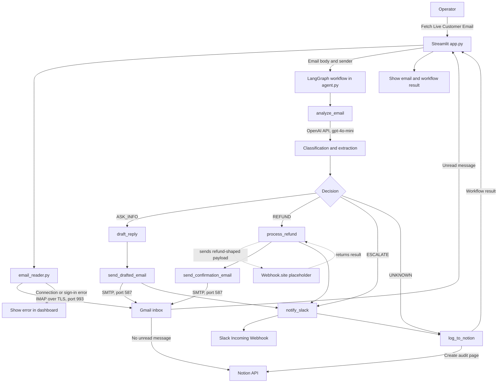

# Autonomous Operations Agent

A Streamlit command center that fetches an unread Gmail message, classifies it with an OpenAI model through LangGraph, and routes it to an operations workflow. This repository is a hackathon prototype; review the integration and approval notes below before using it with real customer data or payment systems.

## Architecture



### Workflow behavior

1. The operator clicks **Fetch Live Customer Email**. The app searches Gmail for unread messages and fetches the newest one without marking it read.
2. If there are no unread messages, the dashboard displays **“No unread emails found in the inbox.”** A connection or authentication failure is shown as an error instead.
3. LangGraph sends the email text to `gpt-4o-mini` to extract a decision, missing details, issue summary, and refund amount.
4. The graph routes the result:
   - `ASK_INFO`: draft a request for missing information, then send it by Gmail SMTP.
   - `REFUND`: post a refund-shaped payload to the configured webhook placeholder, then send a customer update email.
   - `ESCALATE`: notify the team in Slack; no issue-tracker ticket is created.
   - `UNKNOWN`: skip those actions and write an audit record.
5. The `ASK_INFO`, `REFUND`, and `ESCALATE` paths notify Slack and then attempt to create a Notion audit record. The dashboard displays the fetched email and workflow result.

## Important prototype limitations

- **No approval gate is implemented in the graph.** Although the dashboard labels this as human-in-the-loop and the Slack message asks for review, the `REFUND` path sends its webhook request and confirmation email before that Slack notification. Do not use it to process real refunds as-is.
- **The refund integration is a placeholder.** `execute_swytchcode_tool()` posts refund-shaped payloads to the URL configured in `SWYTCHCODE_WEBHOOK_URL`; it does not call the SwytchCode API. `SWYTCHCODE_TOKEN` is listed in `.env.example` but is not currently read by the implementation. Leave the webhook URL unset unless you intend to send data to a trusted endpoint.
- **Escalations do not create issue-tracker tickets.** Software issues are sent to Slack and then logged to Notion; no Jira integration remains in this project.
- **Notion logging is minimal.** The current code creates a page with a decision and timestamp title; it does not log the full extracted record.
- **Configure credentials outside source code.** The app reads secrets from `.env`; `.env` is ignored by Git. Keep real credentials out of source files, screenshots, and public repositories, and rotate any credentials that have already been shared.

## Requirements

- Windows, macOS, or Linux
- Python 3.10 or newer
- Network access to the services you configure. Gmail fetching uses IMAP over TLS on port **993**; outgoing mail uses SMTP with STARTTLS on port **587**.
- An OpenAI API key to run email analysis
- A Gmail account with IMAP access and a Gmail App Password for mailbox access (and sending replies)
- Optional Slack Incoming Webhook and Notion integration credentials

A browser speed test only checks browser traffic; it does not verify that the machine or network can connect to Gmail IMAP on port 993. If fetch fails with a port 993 error, check VPN, firewall, router, or network policy. If it reaches Gmail but cannot sign in, check the Gmail address, App Password, and IMAP access.

## Installation

Open PowerShell in the repository directory and run:

```powershell
py -m venv .venv
.\.venv\Scripts\Activate.ps1
python -m pip install --upgrade pip
python -m pip install -r requirements.txt
Copy-Item .env.example .env
```

Edit `.env` and set the credentials you intend to use:

```dotenv
OPENAI_API_KEY=
GMAIL_ADDRESS=
GMAIL_APP_PASSWORD=
SLACK_WEBHOOK_URL=
NOTION_TOKEN=
NOTION_DATABASE_ID=
SWYTCHCODE_TOKEN=
SWYTCHCODE_WEBHOOK_URL=
```

`SWYTCHCODE_TOKEN` is reserved for a future real SwytchCode integration and is unused by the current code. The webhook URL is also optional; without it, the refund action reports that the placeholder endpoint is not configured. Slack and Notion actions are skipped when their credentials are missing. `.env` is ignored by Git. Keep it local and do not paste its contents into chat, screenshots, or source files.

To start the dashboard:

```powershell
python -m streamlit run app.py
```

Open the local URL printed by Streamlit, usually <http://localhost:8501>.

## Project files

| File | Purpose |
| --- | --- |
| `app.py` | Streamlit dashboard, email fetch action, and workflow result display |
| `email_reader.py` | Gmail IMAP connection, unread-message search, and message parsing |
| `agent.py` | LangGraph nodes, OpenAI analysis, routing, notifications, and audit logging |
| `requirements.txt` | Python dependencies |
| `.env.example` | Names of configurable environment variables |

## Troubleshooting

- **“No unread emails found in the inbox.”** Gmail connected successfully but returned no unread messages.
- **Cannot connect to Gmail IMAP on port 993.** The connection is blocked or unavailable before login. Check DNS, firewall, VPN, router, or network restrictions. Testing from a phone hotspot can help isolate a network block.
- **Gmail sign-in failed.** Confirm IMAP access and use the Gmail App Password, not the normal account password.
- **OpenAI authentication or quota error.** Check `OPENAI_API_KEY`, the key's status, and the API project's access/quota. This is separate from Gmail's IMAP connection.
- **Slack or Notion action failed.** Check the webhook or integration token and ensure the Notion integration has access to the configured database.

## License

No license file is currently included. Add a license before redistributing the project.
